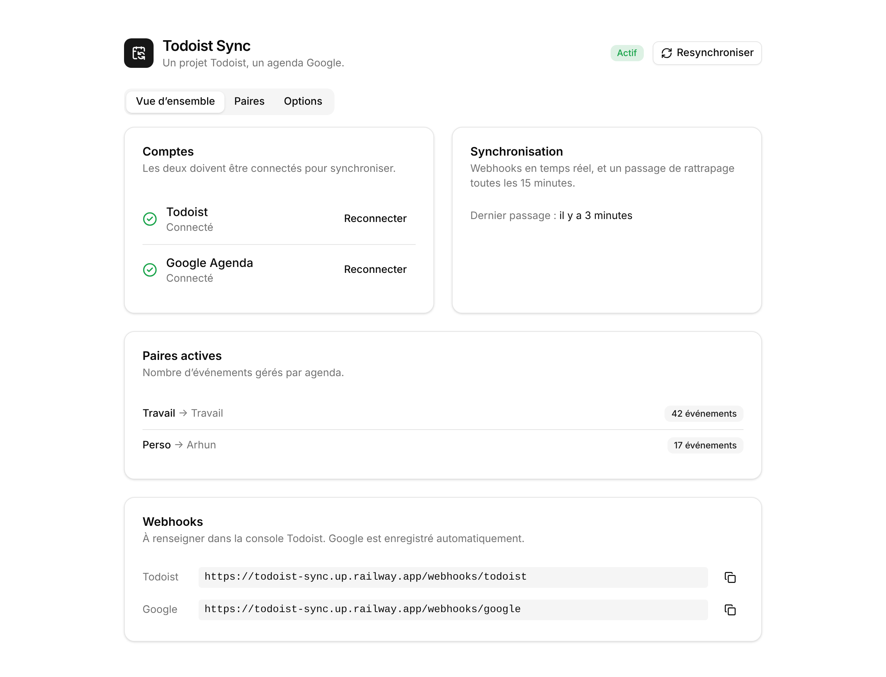
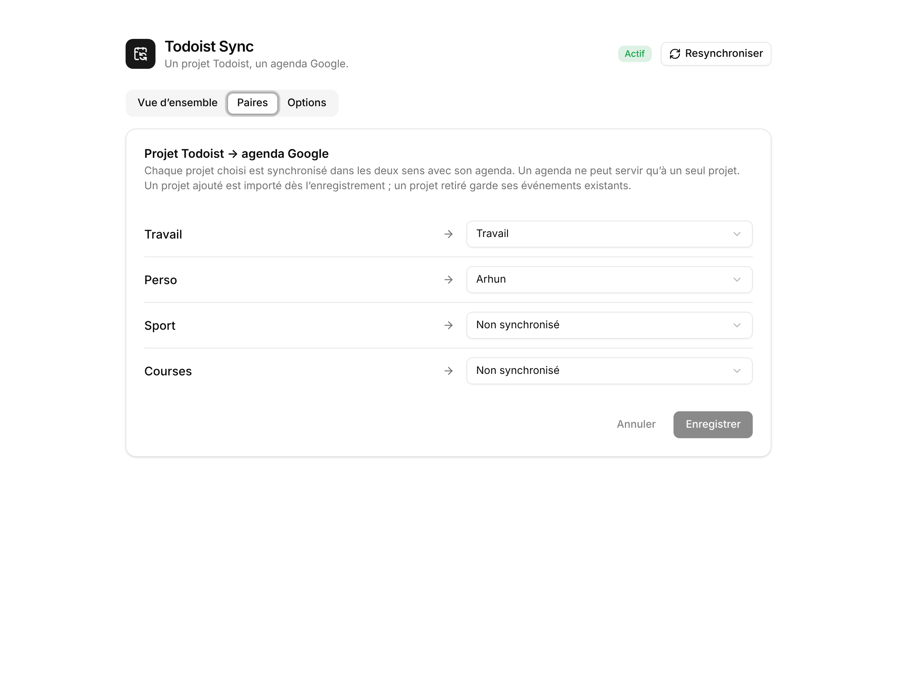
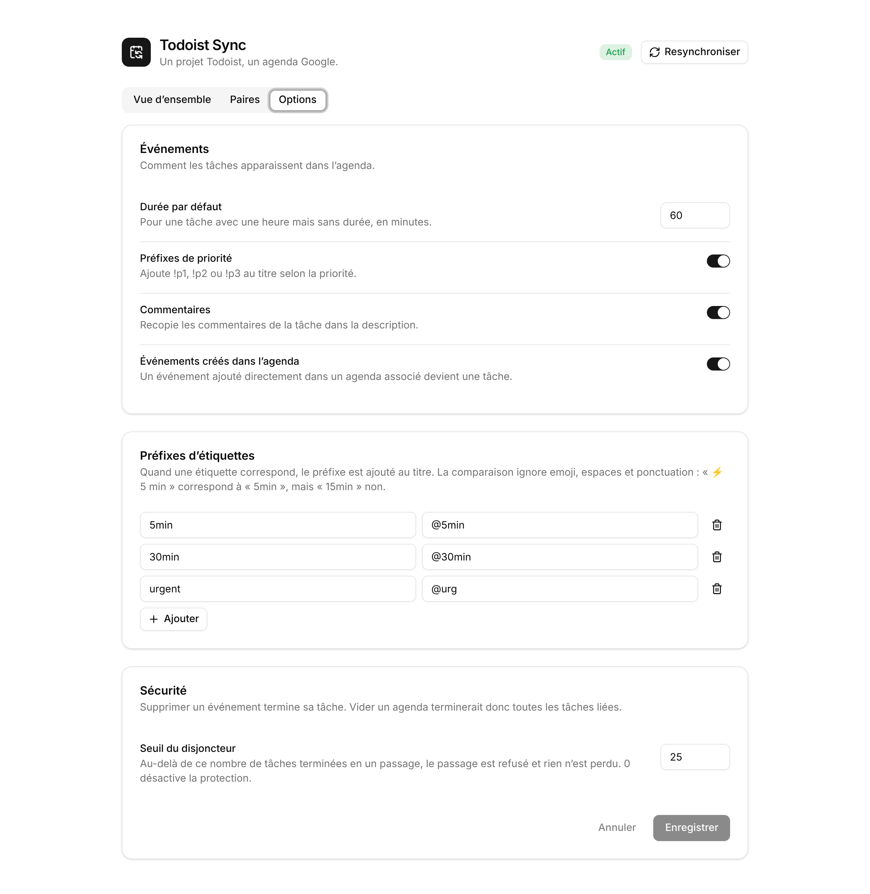

# Todoist Sync

Two-way sync between Todoist projects and Google calendars, **one calendar per
project**. Todoist's official integration puts every task in one calendar.
This app gives each project its own calendar.

It runs as one small Node service with a web UI. You connect your accounts,
pair projects with calendars and change options in the UI. No redeploy is
needed.



<table>
  <tr>
    <td></td>
    <td></td>
  </tr>
</table>

## What syncs

| Todoist | Google Calendar |
|---|---|
| title, description | event title, description |
| due date, no time | all-day event |
| due date with time | timed event (task duration, or 60 min) |
| no due date / unpaired project | no event |
| task completed | event deleted |
| task moved to another paired project | event moved to that calendar |
| recurring task | current occurrence only |

It also works the other way. Renaming, moving or resizing an event updates
the task, and **deleting an event completes the task**. An event created
directly in a paired calendar becomes a task.

Optional extras, set in the UI:
- `!p1`/`!p2`/`!p3` prefixes from priority.
- Markers from labels, such as `@urg`.
- Todoist comments appended to the event description.

**Safety.** The app cannot delete a Todoist task. It never asks for the
delete scope, so the worst it can do is complete tasks, which you can
un-complete. If one pass would complete more than 25 tasks, for example
because a calendar was cleared, a circuit breaker refuses it, and nothing is
applied or lost.

How sync, loop prevention and conflicts work in detail:
[docs/how-it-works.md](docs/how-it-works.md).

## Setup

> Turn off Todoist's official Google Calendar integration first. Two sync
> engines on the same events will fight.

### 1. Create the Todoist app

In the [App Management console](https://app.todoist.com/app/settings/integrations/developer):

- OAuth redirect URL: `https://<your-domain>/setup/todoist/callback`
- Webhook URL: `https://<your-domain>/webhooks/todoist`, events `item:added`,
  `item:updated`, `item:completed`, `item:uncompleted`, `item:deleted`
- Scope: `data:read_write`

Keep the client id and client secret.

### 2. Create the Google OAuth client

In [Google Cloud](https://console.cloud.google.com):

1. Enable the **Google Calendar API**.
2. **Google Auth Platform**:
   - Set the audience to **External**.
   - Add the scope `https://www.googleapis.com/auth/calendar`.
   - **Publish the app**. In *Testing* mode, tokens expire every 7 days. The
     "unverified app" warning is fine for personal use.
3. **Clients → Create client → Web application**, with the redirect URI
   `https://<your-domain>/setup/google/callback`. Leave JavaScript origins
   empty.

### 3. Deploy

Copy `.env.example` to `.env` and fill in the credentials, `PUBLIC_URL` and
`ADMIN_TOKEN` (`openssl rand -hex 24`). **Do set `ADMIN_TOKEN`.** It protects
the UI with basic auth (user `admin`). Without it, anyone with the URL could
reconnect the app to their own accounts.

The app needs a Docker host with a persistent disk at `/data` and public
HTTPS. Step-by-step guides for Railway, a VPS (Compose + Caddy), Coolify,
Fly.io and Render are in **[docs/deployment.md](docs/deployment.md)**.

### 4. Connect and pair

Open your URL:

1. **Vue d'ensemble**: connect Todoist and Google Agenda.
2. **Paires**: pick a calendar for each project, then save. Sync starts
   right away.
3. **Options**: prefixes, comments, default duration, circuit breaker.

Settings saved in the UI are stored in the database and override the matching
environment variables. Those variables only provide the starting values.

## Everyday operations

- **Health**: `GET /health` reports the status and any calendar blocked by
  the circuit breaker.
- **Full resync**: the **Resynchroniser** button in the UI, or
  `pnpm full-sync` on the server. It picks up anything missed and is safe to
  repeat.
- **Lost the database?** Reconnect both accounts and re-pair. On startup the
  app re-attaches existing events by their task id, so nothing is
  duplicated. See [Recovery](docs/how-it-works.md#recovery-after-losing-the-database).

## Development

```bash
pnpm install
pnpm test          # no network needed
pnpm typecheck     # server and UI
pnpm dev           # API on :3000
pnpm dev:web       # UI on :5173, proxies /api to :3000
pnpm build         # server → dist/, UI → dist/public/
```

- Server: Hono, better-sqlite3, in `src/`.
- UI: React, Vite, Tailwind and shadcn/ui, in `web/`.
- `pnpm reconcile:once --dry-run` logs every write it would make without
  making any.
- To receive webhooks locally, run `cloudflared tunnel --url
  http://localhost:3000` and set `PUBLIC_URL` to the tunnel URL.
